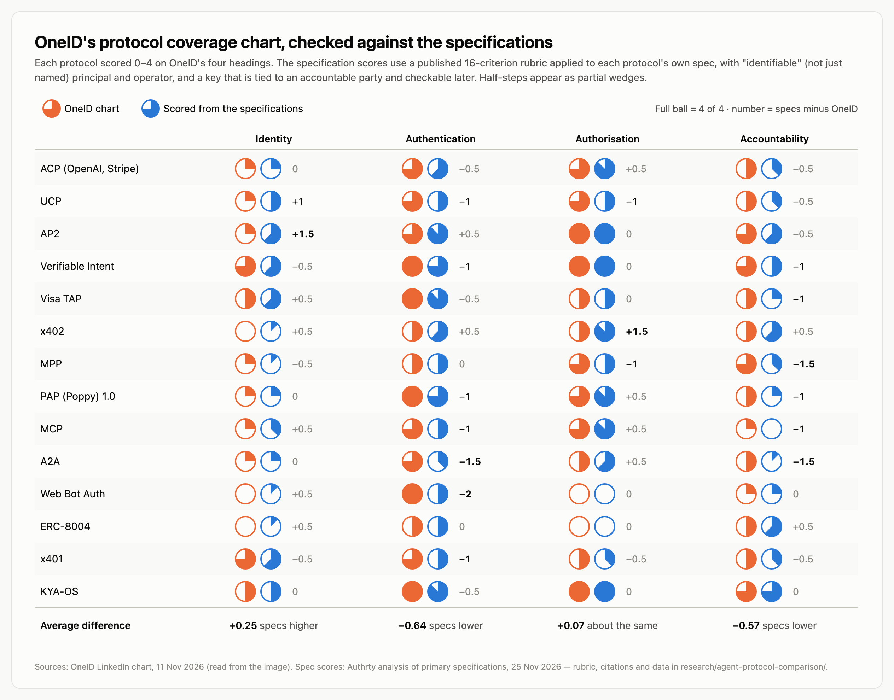

# Archive: comparison with OneID's protocol coverage chart

This is the original comparison that started this research. It is kept here as a record. The main write-up is in [the folder README](../README.md), which scores the protocols on their own terms and goes much further.

On 11 Nov 2026 OneID published a Harvey-ball chart, "Agentic commerce protocol coverage", in a LinkedIn post. It scores 22 protocols on four headings: Identity, Authentication, Authorisation and Accountability. The post describes it as "an AI-scored view" and does not publish criteria. As of 25 Nov 2026 nothing about the chart is on oneid.uk. The post says OneID's own take is still to come.

The comparison re-scored the 14 protocols that appear both in OneID's chart and in our [capability map](../../../PROTOCOLS.md), using a published rubric applied to each protocol's specification text, with a citation for every score. The aim was to check the chart's claims against the specifications, not against another opinion.

OneID's scores, as read from the chart image, are in [oneid-chart-scores.json](oneid-chart-scores.json). The chart above was rendered on 26 Nov 2026 by an earlier version of [make-charts.py](../charts/make-charts.py).

**In short:** on OneID's own headings, the chart broadly matches the specifications. It under-credits identity and over-credits accountability.

**Limitation:** OneID's method is not published. The chart was read from the image, so a ball read one quarter out is possible. The post calls the chart AI-scored.

## The comparison

### Method

**Headings.** OneID's four headings are used as defined in the post. The chart states Identity as "the natural or legal person behind an agent, and how that person is verified".

**Rubric.** Each heading has four yes/no criteria, so a heading scores 0 to 4, and 0 to 4 maps onto a Harvey ball (0 empty, 4 full). Each criterion scores 1 if the core specification meets it. It scores 0.5 if only an optional extension or a SHOULD/MAY requirement meets it, or it is met in part. It scores 0 if the spec does not meet it, leaves it out of scope, or hands it to someone else, such as "the card network handles disputes". The full rubric is in [rubric.md](../rubric.md).

| Heading | Criteria |
|---|---|
| Identity | I1 principal conveyed · I2 operator conveyed · I3 verified by a third party · I4 legal-person grade and cryptographically checkable |
| Authentication | A1 proof of possession of a key · A2 key discoverable from a published source · A3 replay protection · A4 principal's own authentication bound to the agent |
| Authorisation | Z1 explicit grant artefact · Z2 constraints (amount, payee, time, scope) · Z3 grant signed by the principal · Z4 expiry, revocation or narrowed sub-delegation |
| Accountability | C1 action record linked to the grant or identity · C2 record signed or tamper-evident · C3 dispute, refund or liability path · C4 third-party audit (log, registry, reputation or status list) |

**Scoring.** Four agents scored the protocols independently, in parallel. None was shown OneID's scores or our map's ratings. Each read the primary specification and cited the section or field for each criterion. Per-criterion scores and citations are in [scores-group-1.md](../scores-group-1.md) (PAP, MCP, A2A, Web Bot Auth), [scores-group-2.md](../scores-group-2.md) (AP2, Verifiable Intent, UCP, ACP), [scores-group-3.md](../scores-group-3.md) (TAP, x402, MPP, ERC-8004) and [scores-group-4.md](../scores-group-4.md) (x401, KYA-OS). All scores are also in [scores.json](../scores.json).

**Consistency pass.** Afterwards, four cells were changed so that every group applied the rules the same way. The group files show the scores before these changes.

| Protocol | Criterion | From → to | Reason |
|---|---|---|---|
| UCP | A1 | 1 → 0.5 | Request signing is SHOULD, not MUST |
| MCP | I2 | 1 → 0.5 | Client ID Metadata Documents are SHOULD |
| AP2 | C4 | 0.5 → 0 | No log, registry or status list; re-verifiable artefacts alone do not count |
| Verifiable Intent | C4 | 0.5 → 0 | As AP2 |

**Versions read:** PAP 1.0; MCP 2026-07-28 with the Enterprise-Managed Authorization extension; A2A v1.0.1; Web Bot Auth `draft-ietf-webbotauth-httpsig-protocol-01`; AP2 v0.2.0; Verifiable Intent v0.1 draft; UCP v2026-08-25; ACP 2026-04-17; x402 v2 with its extensions; MPP `draft-httpauth-payment-01` with its method drafts; ERC-8004 Draft; x401 Draft 0.2.0; KYA-OS spec v1.0.0. **TAP** has no normative specification, so it was scored from Visa's developer documentation, read through a summarising fetch tool. Treat TAP's scores as provisional.

### Results

Scores are out of 4. "Diff" is our score minus OneID's, so a positive diff means OneID scored the protocol lower than its specification supports.

| Protocol | Identity OneID · ours · diff | Authentication OneID · ours · diff | Authorisation OneID · ours · diff | Accountability OneID · ours · diff |
|---|---|---|---|---|
| ACP (OpenAI, Stripe) | 1 · 1.5 · +0.5 | 3 · 2.5 · −0.5 | 3 · 3.5 · +0.5 | 2 · 1.5 · −0.5 |
| UCP | 1 · 3 · **+2** | 3 · 3 · 0 | 3 · 2 · −1 | 2 · 1.5 · −0.5 |
| AP2 | 1 · 2.5 · **+1.5** | 3 · 3.5 · +0.5 | 4 · 4 · 0 | 3 · 2.5 · −0.5 |
| Verifiable Intent | 3 · 3 · 0 | 4 · 3.5 · −0.5 | 4 · 4 · 0 | 3 · 2 · −1 |
| Visa TAP (provisional) | 2 · 3.5 · **+1.5** | 4 · 4 · 0 | 2 · 2 · 0 | 2 · 1 · −1 |
| x402 | 0 · 1 · +1 | 2 · 3 · +1 | 2 · 3.5 · **+1.5** | 2 · 2.5 · +0.5 |
| MPP | 1 · 0.5 · −0.5 | 2 · 2 · 0 | 3 · 2 · −1 | 3 · 1.5 · **−1.5** |
| PAP (Poppy) 1.0 | 1 · 2 · +1 | 4 · 4 · 0 | 3 · 3.5 · +0.5 | 2 · 1 · −1 |
| MCP | 1 · 1.5 · +0.5 | 3 · 2.5 · −0.5 | 3 · 3.5 · +0.5 | 1 · 0 · −1 |
| A2A | 1 · 1.5 · +0.5 | 3 · 2.5 · −0.5 | 2 · 2.5 · +0.5 | 2 · 0.5 · **−1.5** |
| Web Bot Auth | 0 · 1 · +1 | 4 · 3 · −1 | 0 · 0 · 0 | 1 · 1 · 0 |
| ERC-8004 | 0 · 0.5 · +0.5 | 2 · 2.5 · +0.5 | 0 · 0 · 0 | 2 · 2.5 · +0.5 |
| x401 | 3 · 2.5 · −0.5 | 3 · 2.5 · −0.5 | 2 · 1.5 · −0.5 | 2 · 1.5 · −0.5 |
| KYA-OS | 2 · 3 · +1 | 4 · 4 · 0 | 4 · 4 · 0 | 3 · 3 · 0 |

#### What agrees

- **Broad agreement.** Of the 56 scores, 14 match exactly and 50 are within one quarter-ball. One differs by two quarter-balls or more: UCP Identity.
- **Authentication and Authorisation** match on average: the mean difference is −0.1 and +0.1. The protocols OneID rates highest for authorisation (AP2, Verifiable Intent, KYA-OS) also come out highest from the specs. Web Bot Auth and ERC-8004 are empty for authorisation on both: both specs exclude delegation.

#### Where the chart departs from the specifications

1. **OneID under-scores Identity, by 0.7 of a quarter-ball on average.** The chart gives every protocol at most a half ball except Verifiable Intent and x401. The specs carry more than that:
   - **UCP** (OneID 1, specs 3). Checkout carries a `buyer` object, the `UCP-Agent` header names the platform, and Identity Linking adds a user token.
   - **AP2** (1 vs 2.5). The User Credential is issued by a third party the verifier trusts, as an SD-JWT VC it can check itself.
   - **TAP** (2 vs 3.5, provisional). The Consumer Recognition Object carries an issuer-signed ID token, and agents are onboarded to the payment scheme.

   OneID's reading is closer to ours on I3 and I4 alone, meaning *verified, legal-person-grade* identity. No protocol meets I4 in full. Six meet it in part: AP2, Verifiable Intent, UCP, TAP, x401 and KYA-OS. That is the defensible version of OneID's claim. The chart's version, that these protocols barely convey identity, does not match the specs.
2. **OneID over-scores Accountability, by 0.6 of a quarter-ball on average.** The cause is C3, redress. Not one of the 14 specs defines a dispute path or allocates liability in full.
   - AP2 and UCP get half: AP2 has dispute-verification steps, and UCP has dispute and refund adjustment records.
   - The rest hand redress to the card network, or say it is out of scope.

   The chart gives MPP, AP2, Verifiable Intent and KYA-OS three-quarter balls for accountability. At most, the specs support signed evidence (C1, C2), not redress. MPP's core receipt is not even signed. This supports the post's own thesis ("there is no accountability without identity") more strongly than the chart does.
3. **x402 is under-scored for Authorisation** (OneID 2, specs 3.5). The signed EIP-3009 `authorization` is an explicit, payer-signed grant: it states amount, payee and a validity window, and it expires.
4. **MPP is over-scored for Authorisation and Accountability.** The core receipt is returned only on a SHOULD, is unsigned, and carries no grant or identity. Grant-like features exist only in the payment-method drafts (Tempo `keyAuthorization`, Stripe SPT limits). If the method drafts counted as core, Authorisation would be about 3.5, which would explain OneID's 3.
5. **A2A is over-scored for Accountability** (2 vs 0.5). Task and message objects record the work, but nothing links them to the authenticated identity or a grant, and there is no redress path.
6. **Web Bot Auth is a full ball for Authentication on the chart, three-quarters from the spec.** The spec explicitly excludes authenticating the human (A4).

#### The "process identifier" point

The post says that many protocols claim agent identity when they have "a process identifier", not a legal identity. The specifications bear this out. The agent or operator is identified by a URL, key or token in PAP (`client_id` URL), Web Bot Auth (`Signature-Agent` URL), MCP (client metadata), A2A (Agent Card) and ERC-8004 (an on-chain token ID). None of them attests who the legal person is (I3 = 0 or 0.5). The exceptions all come through third-party credentials, not the agent protocol itself: AP2 and Verifiable Intent (issuer credentials), x401 (verifier-requested digital credentials) and KYA-OS (an optional KYC/KYB credential on the Responsible Party).

#### Amended criteria: "identifiable" and "accountable key"

Three criteria were then tightened, and all 14 protocols re-scored on them:
- **I1 and I2** now ask whether the principal and the operator are *identifiable*, not just named. Someone accountable must be able to tell who they are, at least in a dispute. Self-asserted details or a bare domain score half at most.
- **A2** was "key discoverable from a published source". It now asks whether the key is *bound to an accountable party* and *its validity at the time of use can be checked afterwards*. Being able to look a key up publicly says little for audit: anyone who controls a domain can publish one.

| Protocol | Identity (OneID · before · amended) | Authentication (OneID · before · amended) |
|---|---|---|
| ACP | 1 · 1.5 · 1 | 3 · 2.5 · 2.5 |
| UCP | 1 · 3 · 2 | 3 · 3 · 2 |
| AP2 | 1 · 2.5 · 2.5 | 3 · 3.5 · 3.5 |
| Verifiable Intent | 3 · 3 · 2.5 | 4 · 3.5 · 3 |
| Visa TAP | 2 · 3.5 · 2.5 | 4 · 4 · 3.5 |
| x402 | 0 · 1 · 0.5 | 2 · 3 · 2.5 |
| MPP | 1 · 0.5 · 0.5 | 2 · 2 · 2 |
| PAP (Poppy) | 1 · 2 · 1 | 4 · 4 · 3 |
| MCP | 1 · 1.5 · 1.5 | 3 · 2.5 · 2 |
| A2A | 1 · 1.5 · 1 | 3 · 2.5 · 1.5 |
| Web Bot Auth | 0 · 1 · 0.5 | 4 · 3 · 2 |
| ERC-8004 | 0 · 0.5 · 0.5 | 2 · 2.5 · 2 |
| x401 | 3 · 2.5 · 2.5 | 3 · 2.5 · 2 |
| KYA-OS | 2 · 3 · 2 | 4 · 4 · 3.5 |

**Effect:**
- **Identity.** The gap to OneID narrows from an average of +0.7 to +0.25, a quarter-ball. Requiring identifiability rather than naming brings the specifications closer to OneID's reading. AP2 (+1.5) and UCP (+1) remain above it.
- **Authentication.** It now falls *below* OneID by 0.6 on average. No protocol binds the agent's key to an accountable party *and* lets its validity be checked later. Web Bot Auth, which OneID gives a full ball, drops to half: its keys are self-published, and the draft defines no revocation.

The amended scores are in [scores.json](../scores.json) (`I1p`, `I2p`, `A2p`), with citations in the chain-scores files.
